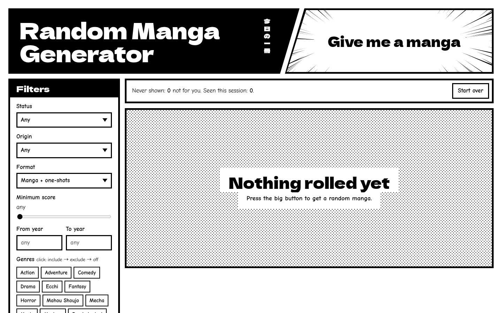

# Random Manga Generator

**[Use the site](https://chickengamer555.github.io/random-manga-generator/)**

Press a button, get a random manga with its cover and synopsis.



- Filter by status, origin, format, score, year and genre.
- A manga won't repeat until you reload the page or press Start over.
- Mark one "Not for me" and it never comes back. That list is saved in your browser.

Data comes from [AniList](https://anilist.co).

## Running it locally

`npm run dev` starts a small server with no dependencies. It adds three things the hosted site can't do:

- Sample pages from [MangaDex](https://mangadex.org), whose API only answers browsers on localhost.
- An "only manga with an English translation" filter, checked through MangaUpdates.
- A "Not for me" list saved to `disliked.json` instead of the browser.

To never be shown manga you've already read, create an untracked `read-list.js`:

```js
window.READ_LIST = {
  ids: new Set([30013]), // AniList ids
  series: [/^dragon ?ball/i], // whole series, matched against titles
  titles: ['Some Title'], // exact titles
};
```
